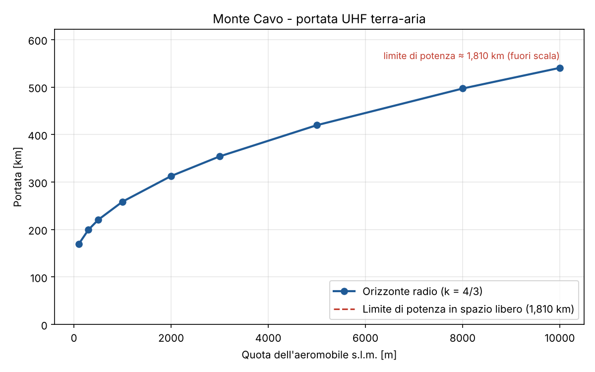
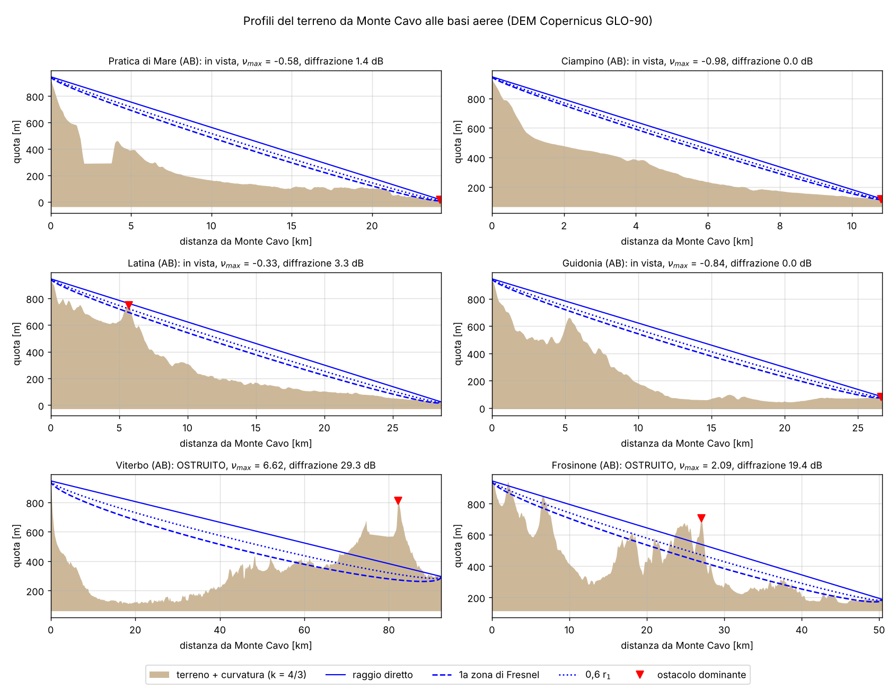
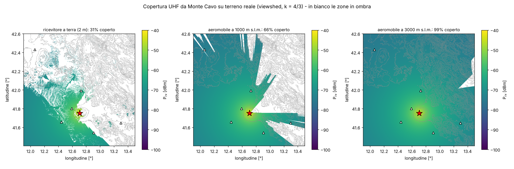

# UHF Ground-to-Air Coverage Study – Monte Cavo (Rome)

In this project I study the radio coverage of a **UHF ground-to-air station** in the military aeronautical band (225–400 MHz), placed on **Monte Cavo** (Colli Albani, about 949 m above sea level), south-east of Rome. I wanted to answer the two questions a radio engineer would ask before installing such a station:

1. Can the six air bases around Rome receive the station, and with what margin?
2. Up to what distance can an aircraft receive it, depending on its altitude?

**Main findings.** On a smooth earth all six bases close the link with a large margin. On the real terrain (Copernicus DEM) four bases are in line of sight, Frosinone is shadowed but still closes with about 12 dB of margin, and **Viterbo is blocked** by the relief south of the town. An aircraft is in view over about 66 % of the area at 1 000 m and 99 % at 3 000 m, with a maximum range set by the radio horizon (259 km at 1 000 m, 354 km at 3 000 m).

**MATLAB is the main implementation.** I built the study at four levels of detail:

| Level | File | Tool | Propagation model |
| --- | --- | --- | --- |
| Analytical study | `matlab/studio_copertura_terra_liscia.m` | MATLAB, no toolboxes | Free space on a smooth spherical earth (k = 4/3) |
| Terrain profiles and shadowing | `matlab/studio_copertura_mapping.m` | MATLAB + **Mapping Toolbox** | Real terrain from a Copernicus DEM: Fresnel clearance, knife-edge diffraction (ITU-R P.526), `viewshed` coverage |
| Terrain study with a propagation model | `matlab/studio_copertura_terreno.m` | MATLAB + Antenna Toolbox | Free space and **Longley-Rice** over real terrain |
| Dynamic link model | `simulink/link_terra_aria.slx` | Simulink, library blocks only | Aircraft flying away from the site, link computed at every time step |

A **Python** version of the analytical and real-terrain studies runs the same steps with the same parameters and serves as an independent cross-check.

---

## Table of contents

1. [Repository structure](#1-repository-structure)
2. [Requirements and how to run](#2-requirements-and-how-to-run)
3. [Input data and sources](#3-input-data-and-sources)
4. [Method](#4-method)
5. [The MATLAB library `matlab/utils`](#5-the-matlab-library-matlabutils)
6. [Analytical study in MATLAB](#6-analytical-study-in-matlab)
7. [Terrain study with the Mapping Toolbox](#7-terrain-study-with-the-mapping-toolbox)
8. [Terrain study with the Antenna Toolbox](#8-terrain-study-with-the-antenna-toolbox)
9. [The Simulink model](#9-the-simulink-model)
10. [Worked example by hand](#10-worked-example-by-hand)
11. [Results](#11-results)
12. [What I learned](#12-what-i-learned)
13. [MATLAB toolboxes for this kind of study](#13-matlab-toolboxes-for-this-kind-of-study)
14. [Limitations and next steps](#14-limitations-and-next-steps)
15. [References](#15-references)

---

## 1. Repository structure

```
UHF-Coverage-Study/
├── README.md
├── matlab/                              MAIN IMPLEMENTATION
│   ├── studio_copertura_terra_liscia.m  analytical study, plain MATLAB
│   ├── studio_copertura_mapping.m       terrain profiles, diffraction and viewshed (Mapping Toolbox)
│   ├── studio_copertura_terreno.m       terrain study, Antenna Toolbox (Longley-Rice)
│   └── utils/
│       ├── distanza_km.m                great-circle distance (haversine)
│       ├── fspl_db.m                    free-space path loss
│       ├── orizzonte_km.m               radio horizon on a smooth earth
│       ├── angolo_elevazione_deg.m      ray elevation with earth curvature
│       ├── guadagno_dipolo_dbi.m        half-wave dipole gain versus elevation
│       ├── fresnel_midpoint.m           first Fresnel zone and earth bulge
│       ├── profilo_terreno.m            terrain profile from the DEM (geointerp)
│       ├── analisi_profilo.m            clearance, Fresnel parameter and diffraction along a profile
│       ├── perdita_knife_edge.m         knife-edge diffraction loss, ITU-R P.526
│       ├── riga.m                       "measured vs theoretical" printout
│       └── salva_fig.m                  saves figures to matlab/figures/
├── simulink/
│   ├── build_link_model.m               builds link_terra_aria.slx from a script
│   └── simula_link_terra_aria.m         maximum link range versus aircraft altitude
├── data/
│   ├── dem_roma.tif                     Copernicus GLO-90 DEM of the area (10 MB)
│   └── README.md                        how I obtained the DEM, licence and citation
├── python/                              CROSS-CHECK
│   ├── studio_copertura_UHF.py          smooth-earth study
│   ├── studio_copertura_terreno_dem.py  real-terrain study on the same DEM
│   └── figures/                         figures and CSV tables
├── risultati_python.txt                 full output of the smooth-earth study
├── risultati_terreno_python.txt         full output of the real-terrain study
└── requirements.txt
```

File names, variable names and code comments are mostly in Italian. The code excerpts in this document keep the original identifiers, with comments in English.

## 2. Requirements and how to run

### MATLAB – analytical study

**MATLAB R2018b or later**, no toolboxes.

```matlab
cd matlab
studio_copertura_terra_liscia
```

The script prints the link-budget tables and saves three figures in `matlab/figures/`.

### MATLAB – terrain profiles and shadowing (Mapping Toolbox)

**MATLAB R2020a or later with the Mapping Toolbox**. The Copernicus DEM of the area is included in `data/dem_roma.tif` (see `data/README.md`).

```matlab
cd matlab
studio_copertura_mapping
```

### MATLAB – terrain study with Longley-Rice

**MATLAB R2020a or later with the Antenna Toolbox** (or the Communications Toolbox) and an internet connection, because terrain data and base maps are downloaded from MathWorks servers.

```matlab
cd matlab
studio_copertura_terreno        % run one section at a time with Ctrl+Enter
```

### Simulink

```matlab
cd simulink
build_link_model                % creates link_terra_aria.slx using library blocks only
simula_link_terra_aria          % flights at 5 altitudes, link range vs theory
```

### Python (cross-check)

```bash
pip install -r requirements.txt
python python/studio_copertura_UHF.py
python python/studio_copertura_terreno_dem.py
```

### Verification

The numbers in this document come from the Python runs (`risultati_python.txt` and `risultati_terreno_python.txt`). The analytical MATLAB script and the Simulink model implement the same equations with the same parameters. I reproduced the Simulink model's equations numerically, with the same 1 s time step: the maximum link range matches the radio horizon within one step (250 m).

---

## 3. Input data and sources

### 3.1 Sites

| Site | Role | ICAO | Latitude | Longitude | Ground elevation [m a.s.l.] |
| --- | --- | --- | --- | --- | --- |
| Monte Cavo | Transmitter | – | 41.7508 N | 12.7083 E | 949 |
| Pratica di Mare | Air base (receiver) | LIRE | 41.6548 N | 12.4452 E | 13 |
| Ciampino | Air base (receiver) | LIRA | 41.7994 N | 12.5949 E | 129 |
| Latina | Air base (receiver) | LIRL | 41.5424 N | 12.9090 E | 29 |
| Guidonia | Air base (receiver) | LIRG | 41.9903 N | 12.7270 E | 88 |
| Viterbo | Air base (receiver) | LIRV | 42.4303 N | 12.0640 E | 305 |
| Frosinone | Air base (receiver) | LIRH | 41.6464 N | 13.2994 E | 181 |

- **Coordinates**: public maps (OpenStreetMap / Google Maps), rounded to four decimal places (about 10 m), more than enough for paths of tens of kilometres.
- **Air base elevations**: published aerodrome elevations (ENAV AIP Italia), converted from feet to metres and rounded.
- **Monte Cavo elevation**: summit height from topographic maps.

I chose real military and state airports around Rome so that the scenario looks like a real design case: one high site serving several bases.

### 3.2 System parameters (design assumptions)

| Parameter | Value | Rationale |
| --- | --- | --- |
| Frequency | 300 MHz (λ = 1 m) | Centre of the NATO military UHF air band (225–400 MHz) |
| Transmit power | 50 W (47 dBm) | Typical power class of ground-to-air UHF transmitters |
| Antenna | Vertical half-wave dipole, 2.15 dBi | Omnidirectional reference antenna, vertical polarization |
| Mast height | 20 m | Typical lattice tower on a hill-top site |
| Cable and connector losses | 2 dB | Short coaxial run plus connectors at 300 MHz |
| Receiver sensitivity | −100 dBm | Conservative: real UHF airband receivers are usually a few dB better |
| Receive antenna gain | 0 dBi | Conservative assumption for aircraft and ground stations |
| Ground receiver height | 2 m | Worst case: a portable or vehicle radio |
| Atmosphere | Standard, k = 4/3 | Standard effective earth radius for propagation planning |

### 3.3 Models and references

| Quantity | Model / reference |
| --- | --- |
| Free-space loss | Friis formula (ITU-R P.525) |
| Effective earth radius | Re = k · 6371 km, k = 4/3 (standard atmosphere, ITU-R P.453) |
| Dipole pattern | Half-wave dipole far field (antenna theory, e.g. Balanis) |
| Fresnel clearance | First Fresnel zone, as used in line-of-sight link planning (ITU-R P.530) |
| Terrain (terrain study only) | Longley-Rice / Irregular Terrain Model, GMTED2010 elevation data |

---

## 4. Method

1. **Scenario.** One transmitter on high ground, six fixed receivers and aircraft at different altitudes.
2. **Antenna.** Elevation pattern of a vertical half-wave dipole, G(θ) = 1.64·[cos(π/2·cos θ)/sin θ]², with θ measured from the dipole axis. I use the actual gain in the direction of each receiver rather than the peak gain.
3. **Distances.** Haversine great-circle distance between the transmitter and each receiver.
4. **Elevation angle.** Ray elevation including earth curvature:

$$
\varepsilon = \arctan\!\left(\frac{h_2 - h_1}{d} - \frac{d}{2R_e}\right)
$$

5. **Link budget.**

$$
P_{rx} = P_{tx} + G_{tx}(\varepsilon) - L_{cables} - FSPL + G_{rx}, \qquad
FSPL = 20\log_{10} d_{km} + 20\log_{10} f_{MHz} + 32.44
$$

6. **Radio horizon** on a smooth earth (heights above sea level):

$$
d_{hor} = \sqrt{2R_e h_1} + \sqrt{2R_e h_2}
$$

7. **First Fresnel zone** clearance at mid-path, compared with the earth bulge:

$$
r_1 = 17.32\sqrt{\frac{d_1 d_2}{f_{GHz}\, d}}\ \text{[m, km]}, \qquad
\text{bulge} = \frac{d_1 d_2}{2R_e}
$$

8. **Ground-to-air range** for aircraft between 100 m and 10 000 m, and coverage maps at 1 000 m and 3 000 m.
9. **Real terrain** from a digital elevation model (Mapping Toolbox): Fresnel clearance along the whole profile, knife-edge diffraction loss of the dominant obstacle and `viewshed` shadow maps.
10. **Cross-check** with the Longley-Rice model (Antenna Toolbox) and **time-domain simulation** of an outbound flight (Simulink).

---

## 5. The MATLAB library `matlab/utils`

Each formula of the method is a small, vectorized function, so the main script reads like the method itself.

```matlab
function d = distanza_km(lat1, lon1, lat2, lon2)      % haversine, inputs in degrees
R = 6371;
dp = deg2rad(lat2 - lat1); dl = deg2rad(lon2 - lon1);
a = sin(dp/2).^2 + cos(deg2rad(lat1)).*cos(deg2rad(lat2)).*sin(dl/2).^2;
d = 2*R*asin(sqrt(a));
end

function el = angolo_elevazione_deg(h1_m, h2_m, d_km, Re_km)
el = atand((h2_m - h1_m)./(d_km*1e3) - d_km./(2*Re_km));
end

function G = guadagno_dipolo_dbi(el_deg)
th = deg2rad(90 - el_deg);                             % angle from the dipole axis
th = min(max(th, 1e-6), pi - 1e-6);                    % avoid 0/0 on the axis
F = cos(pi/2*cos(th)) ./ sin(th);
G = 10*log10(1.64*F.^2 + 1e-12);
end
```

All functions use element-wise operators (`.*`, `./`, `.^`), so they accept scalars, vectors or whole matrices: the same `guadagno_dipolo_dbi` is called on one elevation, on the six sites and on a 600 × 600 grid for the coverage maps.

| Function | Formula |
| --- | --- |
| `fspl_db(d_km, f_MHz)` | 20 log₁₀ d + 20 log₁₀ f + 32.44 |
| `orizzonte_km(h_m, Re_km)` | √(2 Re h) |
| `fresnel_midpoint(h1, h2, d, f, Re)` | r₁, earth bulge and clearance at mid-path |

---

## 6. Analytical study in MATLAB

*File: `matlab/studio_copertura_terra_liscia.m`*

### 6.1 Sites as a table

```matlab
siti = table(["Pratica di Mare (AB)"; "Ciampino (AB)"; "Latina (AB)"; ...
              "Guidonia (AB)"; "Viterbo (AB)"; "Frosinone (AB)"], ...
             [41.6548; 41.7994; 41.5424; 41.9903; 42.4303; 41.6464], ...
             [12.4452; 12.5949; 12.9090; 12.7270; 12.0640; 13.2994], ...
             [13; 129; 29; 88; 305; 181], ...
             'VariableNames', {'Sito', 'lat', 'lon', 'quota'});
```

A MATLAB **table** keeps names, coordinates and elevations together; columns are accessed by name (`siti.lat`, `siti.quota`).

### 6.2 Link budget for all sites in one pass

```matlab
d    = distanza_km(tx.lat, tx.lon, siti.lat, siti.lon);     % 6 distances at once
h_rx = siti.quota + h_rx_ground;
oriz = orizzonte_km(h_tx, Re_km) + orizzonte_km(h_rx, Re_km);
el_s = angolo_elevazione_deg(h_tx, h_rx, d, Re_km);
G_tx = guadagno_dipolo_dbi(el_s);
Prx  = Ptx_dBm + G_tx - L_cavi - fspl_db(d, f_MHz) + G_rx;
[r1, ~, sgombero] = fresnel_midpoint(h_tx, h_rx, d, f_Hz, Re_km);
```

There is no loop: each line processes the six sites together, because the helper functions are vectorized. The results are collected in a second table and printed with `disp`. The script also checks itself against the worked example of section 10:

```matlab
Prx_mano = 46.99 + 2.14 - 2 - (20*log10(24.3) + 20*log10(300) + 32.44);
riga('Pratica di Mare: Prx script vs calcolo a mano', Prx(1), Prx_mano, 'dBm');
```

### 6.3 Coverage maps on a grid

```matlab
xs = linspace(-380, 380, 600);
[X, Y] = meshgrid(xs, xs);                       % local east/north grid [km]
D = max(hypot(X, Y), 0.05);                      % distance from the site
E = angolo_elevazione_deg(h_tx, q, D, Re_km);    % 600 x 600 elevations
P = Ptx_dBm + guadagno_dipolo_dbi(E) - L_cavi - fspl_db(D, f_MHz) + G_rx;
P(D > orizzonte_km(h_tx, Re_km) + orizzonte_km(q, Re_km)) = NaN;   % beyond the horizon
contourf(X, Y, min(max(P, -100), -50), -100:10:-50, 'LineColor', 'none');
```

`meshgrid` builds the grid, the same vectorized functions compute 360 000 received-power values at once, and **logical indexing** sets every point beyond the radio horizon to `NaN`, so `contourf` leaves it blank.

### 6.4 Dipole pattern

The elevation cut is plotted with `polarplot`; since polar plots cannot show negative radii, the dB values are shifted by +30 dB and the tick labels relabelled (`rticklabels({'-30','-20','-10','0'})`).

---

## 7. Terrain study with the Mapping Toolbox

*File: `matlab/studio_copertura_mapping.m`*

The analytical study tells me that every base is above the radio horizon, but it assumes a smooth earth. Here I bring in the real terrain from the **Copernicus GLO-90 digital elevation model** (90 m grid) and use the Mapping Toolbox to answer three questions: are the assumed site elevations right, does the terrain obstruct the first Fresnel zone of any link, and which areas are in the radio shadow of the hills.

### 7.1 Terrain data

The DEM is a 10 MB GeoTIFF covering 41.4–42.6 N, 11.9–13.5 E (1 440 × 1 920 samples at 3 arc-seconds), which I downloaded from OpenTopography and included in the repository (see `data/README.md`). It is read with `readgeoraster`, which returns the elevation matrix `Z` and a geographic raster reference `R` that maps each cell to latitude and longitude:

```matlab
[Z, R] = readgeoraster(file_dem, 'OutputType', 'double');
Z(Z < -500) = NaN;                 % no-data values
Z(isnan(Z)) = 0;                   % sea and empty cells at 0 m
```

The script stops with a clear message if the file is missing or does not cover all sites.

### 7.2 Checking the site elevations

```matlab
tx.quota       = geointerp(Z, R, tx.lat, tx.lon, 'linear');
siti.quota_DEM = geointerp(Z, R, siti.lat, siti.lon, 'linear');
```

`geointerp` interpolates the DEM at any latitude/longitude, so I can compare the elevations I assumed from the aerodrome data with the terrain model. The DEM value of Monte Cavo is then used as the actual transmitter ground height. Copernicus is a surface model (DSM): it includes buildings and vegetation, so small differences at the airports are expected.

### 7.3 Terrain profiles

```matlab
function [d_km, z_m, lat, lon] = profilo_terreno(Z, R, lat1, lon1, lat2, lon2, npts)
lat = linspace(lat1, lat2, npts);
lon = linspace(lon1, lon2, npts);
z_m = geointerp(Z, R, lat, lon, 'linear');
z_m(isnan(z_m)) = 0;
d_km = distanza_km(lat1, lon1, lat, lon);
end
```

Each link is sampled at 1 500 points (one every 7–60 m depending on the path length, finer than the 90 m DEM grid). For paths up to about 100 km, a straight line in latitude/longitude is an excellent approximation of the great circle.

### 7.4 Fresnel clearance and diffraction along the profile

For every point of the profile, at distance d₁ from the transmitter and d₂ from the receiver, `analisi_profilo.m` computes:

$$
y_{ray} = h_1 + (h_2 - h_1)\frac{d_1}{D}, \qquad
y_{obs} = z(d_1) + \frac{d_1 d_2}{2R_e}, \qquad
r_1 = \sqrt{\frac{\lambda\, d_1 d_2}{D}}
$$

$$
c = y_{ray} - y_{obs}, \qquad
\nu = -\sqrt{2}\,\frac{c}{r_1}
$$

where c is the clearance between the direct ray and the terrain lifted by the earth bulge, and ν is the Fresnel-Kirchhoff diffraction parameter (ν < 0 means the obstacle is below the ray). The point with the largest ν is the **dominant obstacle**, and its loss is computed with the ITU-R P.526 single knife-edge approximation:

$$
J(\nu) = 6.9 + 20\log_{10}\!\left(\sqrt{(\nu - 0.1)^2 + 1} + \nu - 0.1\right) \ \text{dB}, \qquad \nu > -0.78
$$

```matlab
lam = 3e8 / f_Hz;
d1 = d_km(:).' * 1e3;  d2 = (D - d_km(:).') * 1e3;
a.raggio   = h1 + (h2 - h1) * d1 / (D*1e3);
a.bulge    = d1 .* d2 / (2 * Re_km * 1e3);
a.ostacolo = z_m(:).' + a.bulge;
a.sgombero = a.raggio - a.ostacolo;
a.r1       = sqrt(lam * d1 .* d2 / (D*1e3));
a.nu       = -sqrt(2) * a.sgombero ./ max(a.r1, 1e-9);
[a.nu_max, k] = max(a.nu(interni));          % dominant obstacle
a.J_dB     = perdita_knife_edge(a.nu_max);
a.los      = all(a.sgombero(interni) > 0);
```

The whole profile is processed with vectorized operations. I validated the function on three cases with a known answer: a flat profile reproduces the mid-path clearance of the analytical study (6.2·r₁ for Pratica di Mare), a ridge exactly touching the ray gives ν = 0 and J = 6.0 dB, and a ridge 30 m above the ray on a 50 km path gives ν = 0.380, identical to the closed-form value, and J = 9.3 dB.

The received power on real terrain is the free-space budget minus the diffraction loss:

$$
P_{rx,terrain} = P_{rx,free\ space} - J(\nu_{max})
$$

The script plots the six profiles (terrain plus earth bulge, direct ray, first Fresnel zone and the 0.6·r₁ limit, dominant obstacle) and prints a table with line of sight, minimum clearance, ν, diffraction loss, received power and margin for each base.

### 7.5 Radio shadow maps with `viewshed`

```matlab
[Zv, Rv] = georesize(Z, R, 0.5);                    % 180 m grid, faster viewshed
vis = viewshed(Zv, Rv, tx.lat, tx.lon, h_mast, h_tgt, 'AGL', rif, 6371e3, 4/3*6371e3);
P(~vis) = NaN;                                      % cells in the terrain shadow
```

`viewshed` returns, for every cell of the DEM, whether a target at the given height can see the antenna on Monte Cavo, using the effective earth radius (the last argument, 4/3 of the real radius). I run it for three targets: a ground receiver 2 m above the terrain (`'AGL'`), and aircraft at 1 000 m and 3 000 m above sea level (`'MSL'`). Where a cell is visible I compute the free-space received power with the dipole gain; shadowed cells are left blank. The script reports the percentage of the DEM area that is both in view and above the receiver sensitivity.

This gives the realistic counterpart of the smooth-earth coverage circles: the Alban Hills, the Apennines to the east and the Volsci mountains to the south-east cast radio shadows that the analytical study cannot show.

### 7.6 Results on the real terrain

I cross-checked the whole analysis in Python on the same DEM (`python/studio_copertura_terreno_dem.py`): same profiles, same formulas, and a radial-sweep implementation of the viewshed (7 200 azimuths, one sample every 45 m) that agrees with an exact line-of-sight check on 95 % of randomly chosen cells, the differences being on the shadow edges.

**Site elevations.** The DEM gives 926 m for the Monte Cavo site, against the 949 m I had assumed, and airport elevations within 12 m of the aerodrome data.

**Ground links (receiver at 2 m above the terrain)**

| Site | Distance [km] | Line of sight | Min clearance / r₁ | ν max | Diffraction [dB] | Dominant obstacle at [km] | Prx [dBm] | Margin [dB] |
| --- | --- | --- | --- | --- | --- | --- | --- | --- |
| Pratica di Mare | 24.3 | yes | 0.41 | −0.58 | 1.4 | 24.3 (receiver end) | −63.9 | 36.1 |
| Ciampino | 10.8 | yes | 0.69 | −0.98 | 0.0 | 10.8 (receiver end) | −55.6 | 44.4 |
| Latina | 28.5 | yes | 0.23 | −0.33 | 3.3 | 5.7 (Alban Hills rim) | −67.2 | 32.8 |
| Guidonia | 26.7 | yes | 0.59 | −0.84 | 0.0 | 26.6 (receiver end) | −63.4 | 36.6 |
| Viterbo | 92.4 | **no** | −4.68 | 6.62 | 29.3 | 82.2 (relief south of Viterbo) | −103.4 | **−3.4** |
| Frosinone | 50.4 | **no** | −1.48 | 2.09 | 19.4 | 27.1 (ridge along the path) | −88.3 | 11.7 |

The terrain changes the conclusion of the smooth-earth study. Four links are in line of sight. Pratica di Mare, Ciampino and Guidonia have their minimum clearance in the last few hundred metres, where the 2 m receiver sits on the surface model. Latina grazes the rim of the Alban Hills 5.7 km from the site, with 0.23·r₁ of clearance and 3.3 dB of diffraction loss. **Viterbo is blocked** by the relief about 10 km before the airport: the single knife-edge estimate gives 29 dB of loss and a negative margin, so this link would need a higher receiving mast, a relay or a different site. **Frosinone is also blocked**, by a ridge 27 km along the path, but still closes with about 12 dB of margin.

**Coverage maps (`viewshed`)**

| Target | Area of the DEM in view and above −100 dBm |
| --- | --- |
| Ground receiver, 2 m above the terrain | 30.8 % |
| Aircraft at 1 000 m a.s.l. | 65.6 % |
| Aircraft at 3 000 m a.s.l. | 98.8 % |

On the ground, coverage is mostly the Roman plain and the coast in front of the Alban Hills; the Apennine valleys to the north-east and the area behind the Lepini mountains are in shadow. At 1 000 m the aircraft is still hidden behind the main ridges in several sectors, while at 3 000 m practically the whole area is covered.

---

## 8. Terrain study with the Antenna Toolbox

*File: `matlab/studio_copertura_terreno.m`*

The analytical study assumes a smooth earth. To include real hills and mountains I use the RF propagation functions of the Antenna Toolbox, which download terrain elevation data and implement the Longley-Rice (Irregular Terrain) model.

```matlab
ant = design(dipole, f);                          % half-wave dipole designed at 300 MHz
tx = txsite("Name", "Monte Cavo", ...
    "Latitude", 41.7508, "Longitude", 12.7083, ...
    "Antenna", ant, "AntennaHeight", hTx, ...
    "TransmitterFrequency", f, "TransmitterPower", Ptx_W, "SystemLoss", Lcavi_dB);

pmFS = propagationModel("freespace");             % reference
pmLR = propagationModel("longley-rice");          % irregular terrain

coverage(tx, pmLR, "SignalStrengths", Srx_dBm:10:-60, ...
    "MaxRange", 120e3, "ReceiverAntennaHeight", 2);   % ground coverage map

rxTerra = rxsite("Name", nomi, "Latitude", lat, "Longitude", lon, ...
    "AntennaHeight", 2, "ReceiverSensitivity", Srx_dBm);
visib = los(tx, rxTerra);                         % line of sight over real terrain
PrxLR = sigstrength(rxTerra, tx, pmLR);           % received power, Longley-Rice
link(rxTerra, tx, pmLR);                          % green / red links in Site Viewer
```

The script is organised in ten sections (`%%`), to be run one at a time:

1. System parameters.
2. Dipole designed with `design(dipole, f)`: 3D pattern and elevation cut, computed by the toolbox's full-wave solver.
3. Transmitter site in Site Viewer.
4. Free-space and Longley-Rice propagation models.
5. Ground coverage map (receiver at 2 m).
6. Point-to-point links to the six bases: distance, line of sight, free-space and Longley-Rice received power, margin.
7. Hand-calculated free-space budget compared with the toolbox.
8. Ground-to-air coverage map for an aircraft at 1 000 m.
9. Received power versus aircraft altitude at a point about 150 km away.
10. Questions for the technical report.

Comparing section 6 of this script with the analytical study shows how much the real terrain changes the smooth-earth result, especially for the most distant bases (Viterbo and Frosinone).

---

## 9. The Simulink model

`simulink/build_link_model.m` builds **link_terra_aria** entirely from a script, using library blocks only. While the MATLAB scripts compute the coverage as a static map, the Simulink model follows a single aircraft **in time**: it flies radially away from Monte Cavo at constant altitude, and at every 1 s step the model computes the link budget and decides whether the link is up.

### 9.1 Block diagram

```
Clock ─► Gain (v) ─► Bias (d0) ──► d(t) ─┬──────────────────────────► FSPL (Fcn) ────────┐
                                         │                                                ▼
Constant (h_air) ─► Mux ◄────────────────┤          Constant (Ptx − L + Grx) ─► Sum (+ + −) ─► Prx ─► Sum (−S) ─► margin
                     │                   │                                    ▲                              │
                     └─► Elevation (Fcn) ─► Dipole gain (Fcn) ────────────────┘                    Compare To Zero (> 0)
                                         │                                                                   │
                                         └─► Relational Operator (d < d_hor) ◄─ Constant (horizon) ──► AND ──► link OK
```

| Block | Library | Function |
| --- | --- | --- |
| Clock, Gain, Bias | Sources, Math Operations | Distance d(t) = d₀ + v·t |
| Mux + Fcn "Elevazione" | Signal Routing, User-Defined Functions | atan((h_air − h_tx)/(1000 d) − d/(2Re)) |
| Fcn "Guadagno dipolo" | User-Defined Functions | 10 log₁₀(1.64·(cos(π/2·sin ε)/cos ε)²) |
| Fcn "FSPL" | User-Defined Functions | 20 log₁₀ d + 20 log₁₀ f + 32.44 |
| Sum "Potenza ricevuta" | Math Operations | (Ptx − L + Grx) + G_tx − FSPL |
| Sum "Margine" + Compare To Zero | Math Operations, Logic and Bit Operations | Margin over the receiver sensitivity, > 0 |
| Constant "Orizzonte radio" + Relational Operator | Sources, Logic and Bit Operations | d < √(2Re h_tx) + √(2Re h_air) |
| Logical Operator (AND) | Logic and Bit Operations | Link up = positive margin AND line of sight |
| To Workspace, Scope | Sinks | `d_out`, `prx_out`, `margine_out`, `link_out` |

### 9.2 Building the model from a script

```matlab
add_block('simulink/Sources/Clock', blk('Tempo'));
add_block('simulink/Math Operations/Gain', blk('Velocita'), 'Gain', 'v_kms');
add_block('simulink/Math Operations/Bias', blk('Distanza iniziale'), 'Bias', 'd0');

add_block('simulink/User-Defined Functions/Fcn', blk('Elevazione'), ...
    'Expr', 'atan((u(2) - h_tx)/(u(1)*1000) - u(1)/(2*Re))');
add_block('simulink/User-Defined Functions/Fcn', blk('FSPL'), ...
    'Expr', '20*log10(u(1)) + 20*log10(f_MHz) + 32.44');

add_block('simulink/Logic and Bit Operations/Relational Operator', blk('In vista'), 'Operator', '<');
add_block('simulink/Logic and Bit Operations/Logical Operator', blk('Collegamento OK'), 'Operator', 'AND');

set_param(mdl, 'Solver', 'FixedStepDiscrete', 'FixedStep', '1', 'StopTime', 'T_sim');
```

1. Each equation of the link budget is a **Fcn** block: its expression uses the input vector `u` and workspace variables (`h_tx`, `Re`, `f_MHz`), so the physics stays readable inside the model.
2. The two inputs of the elevation block (distance and altitude) are combined with a **Mux** and read as `u(1)` and `u(2)`.
3. The link decision is pure logic: a **Compare To Zero** on the margin, a **Relational Operator** for the line of sight and an **AND** gate.
4. The model has no continuous states, so it runs with the **fixed-step discrete** solver, one step per second.
5. All parameters are workspace variables; `build_link_model.m` sets default values with `assignin('base', ...)`.

### 9.3 Simulating several flights

```matlab
quote = [100 300 1000 3000 10000];
for k = 1:numel(quote)
    in = Simulink.SimulationInput(mdl);
    in = in.setVariable('h_air', quote(k));       % only the altitude changes
    out = sim(in);
    d = out.d_out; prx = out.prx_out; ok = logical(out.link_out);
    i_last = find(ok, 1, 'last');                 % last instant with a working link
    d_teo = sqrt(2*Re*h_tx/1000) + sqrt(2*Re*quote(k)/1000);
    riga('maximum link range', d(i_last), d_teo, 'km');
end
```

Each flight starts 5 km from the site and moves away at 900 km/h for 40 minutes. `find(ok, 1, 'last')` returns the last time step with the link up, and the script compares that distance with the radio horizon.

**Expected results** (the model's equations reproduced numerically with the same 1 s step):

| Aircraft altitude | Maximum link range | Radio horizon (theory) | Received power at maximum range | Minimum margin during the flight |
| --- | --- | --- | --- | --- |
| 100 m | 169.5 km | 169.5 km | −79.4 dBm | 20.6 dB |
| 300 m | 199.5 km | 199.7 km | −80.8 dBm | 19.2 dB |
| 1 000 m | 258.5 km | 258.7 km | −83.1 dBm | 16.9 dB |
| 3 000 m | 354.0 km | 354.1 km | −85.8 dBm | 14.2 dB |
| 10 000 m | 540.3 km | 540.5 km | −89.5 dBm | 10.5 dB |

The link is always lost at the radio horizon, never because of insufficient power: the margin is still 10–20 dB when the aircraft disappears below the horizon.

---

## 10. Worked example by hand

Monte Cavo → Pratica di Mare:

| Quantity | Calculation | Result |
| --- | --- | --- |
| Distance | haversine | 24.3 km |
| Free-space loss | 20 log₁₀(24.3) + 20 log₁₀(300) + 32.44 = 27.71 + 49.54 + 32.44 | 109.7 dB |
| Received power | 47.0 + 2.14 − 2 − 109.7 | **−62.6 dBm** |
| Margin | −62.6 − (−100) | **37.4 dB** |
| Radio horizon | √(2 · 8495 · 0.969) + √(2 · 8495 · 0.015) = 128.3 + 16.0 | 144.3 km > 24.3 km → line of sight |
| Fresnel radius at mid-path | 17.32 · √(12.15 · 12.15 / (0.3 · 24.3)) | 78 m |
| Earth bulge at mid-path | 12.15 · 12.15 / (2 · 8495) · 1000 | 8.7 m |
| Clearance | (969 + 15)/2 − 8.7 = 483 m → 483 / 78 | 6.2 · r₁ |

---

## 11. Results

### 11.1 Ground links (receiver at 2 m)

| Site | Distance [km] | LOS (smooth earth) | Elevation | Dipole gain | Prx [dBm] | Margin [dB] | Fresnel r₁ [m] | Clearance / r₁ |
| --- | --- | --- | --- | --- | --- | --- | --- | --- |
| Pratica di Mare | 24.3 | yes | −2.33° | 2.14 dBi | −62.6 | 37.4 | 78.0 | 6.2 |
| Ciampino | 10.8 | yes | −4.45° | 2.11 dBi | −55.6 | 44.4 | 52.1 | 10.5 |
| Latina | 28.5 | yes | −1.98° | 2.14 dBi | −64.0 | 36.0 | 84.5 | 5.8 |
| Guidonia | 26.7 | yes | −1.98° | 2.14 dBi | −63.4 | 36.6 | 81.7 | 6.4 |
| Viterbo | 92.4 | yes | −0.72° | 2.15 dBi | −74.2 | 25.8 | 152.0 | 3.4 |
| Frosinone | 50.4 | yes | −1.06° | 2.15 dBi | −68.9 | 31.1 | 112.3 | 4.8 |

These are smooth-earth values. On the real terrain Viterbo and Frosinone are not in line of sight: see section 7.6.

### 11.2 Ground-to-air range versus aircraft altitude

| Aircraft altitude [m a.s.l.] | Radio horizon [km] | Prx at horizon [dBm] | Margin [dB] |
| --- | --- | --- | --- |
| 100 | 170 | −79.4 | 20.6 |
| 300 | 200 | −80.9 | 19.1 |
| 500 | 220 | −81.7 | 18.3 |
| 1 000 | 259 | −83.1 | 16.9 |
| 2 000 | 313 | −84.7 | 15.3 |
| 3 000 | 354 | −85.8 | 14.2 |
| 5 000 | 420 | −87.3 | 12.7 |
| 8 000 | 497 | −88.8 | 11.2 |
| 10 000 | 540 | −89.5 | 10.5 |

With 50 W the link budget alone would allow about 1 810 km in free space.

### 11.3 Figures

**Elevation pattern of the half-wave dipole**


**Ground-to-air range versus aircraft altitude**



**Ground-to-air coverage maps on a smooth earth (aircraft at 1 000 m and 3 000 m)**


**Terrain profiles from Monte Cavo to the six bases (Copernicus DEM)**



**Coverage on the real terrain (`viewshed`)**



The figures shown here come from the Python cross-check; the MATLAB scripts produce the same plots in `matlab/figures/`.

---

## 12. What I learned

- **Range is limited by the radio horizon, not by transmit power.** The link budget would reach about 1 800 km, but the real range is 170–540 km depending on the aircraft altitude. At UHF, antenna height is worth more than power, which is why these stations sit on hills and mountains. The Simulink flights show this directly: the link is lost at the horizon with 10–20 dB of margin still available.
- **A smooth earth hides the real problems.** On a smooth earth all six ground links close with 26–44 dB of margin and generous Fresnel clearance. On the real terrain the Viterbo link is blocked and loses about 29 dB, Frosinone loses about 19 dB, and Latina only grazes the Alban Hills. A terrain profile is the first thing to check on any UHF link.
- **Ground coverage and air coverage are different problems.** From the same site, only about 31 % of the area is visible to a receiver on the ground, against 99 % for an aircraft at 3 000 m.
- **The antenna pattern matters little for these links**, because every ray leaves the antenna within a few degrees of the horizon. It would matter for aircraft flying close to and above the site, where the dipole has a null.

## 13. MATLAB toolboxes for this kind of study

The analytical study and the Simulink model need no toolboxes; the terrain studies use the Mapping Toolbox and the Antenna Toolbox. These are the toolboxes relevant to this kind of work:

| Toolbox | What it adds to this project |
| --- | --- |
| **Antenna Toolbox** | Full-wave antenna design (`dipole`, `design`, `pattern`) and the RF propagation functions used in the terrain study: `txsite`, `rxsite`, `propagationModel`, `coverage`, `sigstrength`, `link`, Site Viewer. The TIREM model (`propagationModel("tirem")`) requires this toolbox ([MathWorks](https://it.mathworks.com/help/comm/ref/propagationmodel.html)). |
| **Communications Toolbox** | Contains the same site-based propagation functions, including Longley-Rice, signal strength, coverage maps and link status ([MathWorks](https://in.mathworks.com/help/comm/propagation-and-channel-models.html)), plus channel and fading models for a full digital link simulation. |
| **Mapping Toolbox** (used in this project) | Reads real terrain (`readgeoraster` for GeoTIFF and DTED), interpolates it (`geointerp`), resamples it (`georesize`) and computes line of sight (`los2`) and visible areas (`viewshed`) with an effective earth radius such as 4/3 ([MathWorks](https://kr.mathworks.com/help/map/determine-and-visualize-visibility-across-terrain.html)). MathWorks shows the same approach for ground-to-air radar coverage of aircraft over terrain ([MathWorks](https://www.mathworks.com/help/map/visualize-aircraft-line-of-sight-over-terrain.html)). |
| **RF Toolbox** | Cascade budget of the RF chain (cables, filters, amplifiers, receiver noise figure) to replace the fixed 2 dB loss and −100 dBm sensitivity with computed values. |
| **Phased Array System Toolbox** | Antenna arrays and beamforming: the natural next step to replace the single dipole with a directional or sectorized array. |
| **Radar Toolbox** | Radar equation, propagation factor and coverage diagrams, if the station is studied as a radar rather than a communication link. |

## 14. Limitations and next steps

**Limitations.**
- The analytical study and the Simulink model use a smooth earth; real terrain is included in the Mapping Toolbox and Longley-Rice studies.
- The Mapping Toolbox study uses a single dominant knife-edge: multiple obstacles (Deygout or Bullington methods) and ground reflection are not modelled.
- Copernicus is a surface model (DSM): buildings and trees near the airports slightly raise the terrain.
- The receiver sensitivity and the aircraft antenna gain are fixed assumptions, not computed from a receiver design.
- Fading, multipath over sea and variations of the refractivity (k ≠ 4/3) are not modelled.
- Site coordinates and elevations are approximate.

**Next steps I plan to work on.**
- Extend the diffraction model to multiple obstacles (Deygout method, ITU-R P.526) and compare the result with Longley-Rice.
- Combine `viewshed` with the Simulink flight model, so that the aircraft's link status also accounts for terrain shadowing along a real flight path.
- Use a dedicated air-to-ground model (ITU-R P.528) for the aircraft coverage.
- Add fade margins and the effect of sub-refraction (k < 4/3).
- Model the RF chain with the RF Toolbox to derive sensitivity and losses.
- Study interference and electromagnetic compatibility with the other transmitters on the same site, a real issue on crowded hill-top sites like Monte Cavo.
- Extend the Simulink model with a full flight path (latitude, longitude, altitude) instead of a radial outbound leg.

## 15. References

- ITU-R P.525 – Calculation of free-space attenuation.
- ITU-R P.453 – The radio refractive index: its formula and refractivity data.
- ITU-R P.530 – Propagation data and prediction methods for terrestrial line-of-sight systems.
- ITU-R P.528 – Propagation curves for aeronautical mobile and radionavigation services.
- ITU-R P.526 – Propagation by diffraction.
- Copernicus DEM GLO-90 – European Space Agency, distributed by OpenTopography.
- C. A. Balanis, *Antenna Theory: Analysis and Design*, Wiley.
- MathWorks documentation: [Propagation and channel models](https://in.mathworks.com/help/comm/propagation-and-channel-models.html), [Determine and visualize visibility across terrain](https://kr.mathworks.com/help/map/determine-and-visualize-visibility-across-terrain.html).

## Author

**Luca Buccilli** – M.Sc. in Telecommunications Engineering, Sapienza University of Rome
