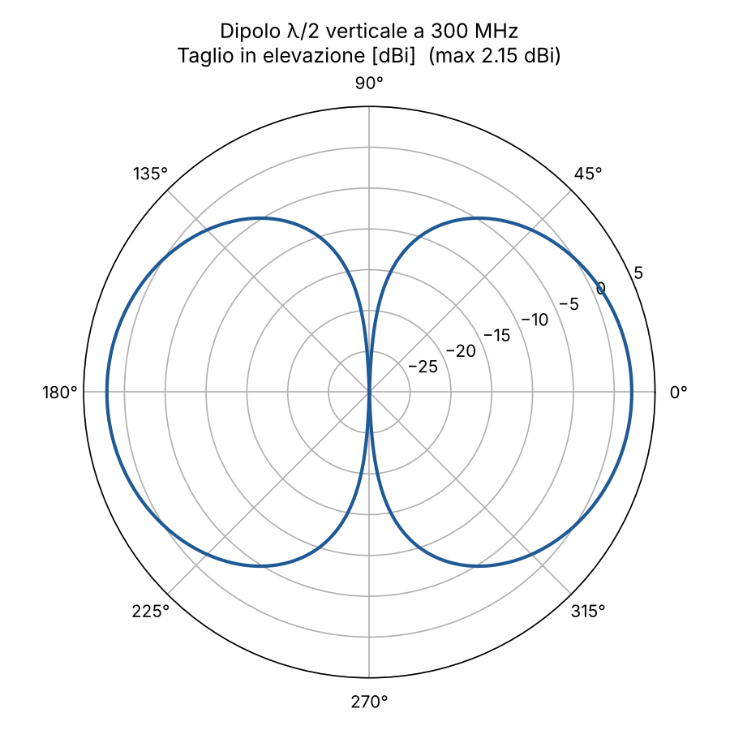
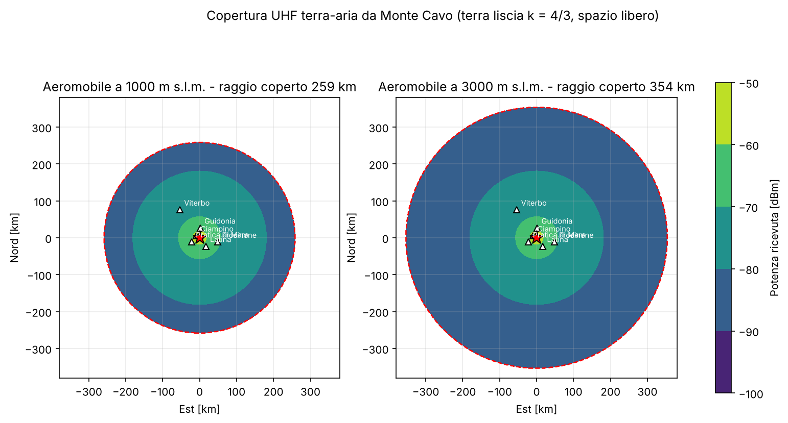

# UHF Ground-to-Air Coverage Study – Monte Cavo (Rome)

Radio coverage study of a UHF ground-to-air station in the military aeronautical band
(225–400 MHz), placed on Monte Cavo (Colli Albani, ~949 m a.s.l.) near Rome.
The study checks which ground sites and which aircraft, at which altitude, can receive
the station.

The same scenario is implemented in two tools:

| File | Tool | Propagation model |
|---|---|---|
| `studio_copertura_UHF.py` | Python (NumPy, pandas, Matplotlib) | Free space on a smooth spherical earth (k = 4/3) |
| `studio_copertura_UHF.m` | MATLAB + Antenna Toolbox | Free space and **Longley-Rice** on real terrain (GMTED2010) |

Code comments are in Italian.

## Scenario and assumptions

| Parameter | Value |
|---|---|
| Frequency | 300 MHz (λ = 1 m) |
| Transmit power | 50 W (47 dBm) |
| Antenna | Vertical half-wave dipole, 2.15 dBi, 20 m mast |
| Cable and connector losses | 2 dB |
| EIRP | 47.1 dBm |
| Receiver sensitivity | −100 dBm (conservative assumption) |
| Receive antenna gain | 0 dBi |
| Atmosphere | Standard, effective earth radius k = 4/3 |

Ground receivers (antenna at 2 m) are six air bases around Rome: Pratica di Mare, Ciampino,
Latina, Guidonia, Viterbo and Frosinone. Site coordinates and elevations are approximate.

## Method (Python version)

1. **Antenna**: elevation pattern of a vertical λ/2 dipole,
   G(θ) = 1.64 · [cos(π/2 · cos θ) / sin θ]².
2. **Link budget**: Prx = Ptx + Gtx(elevation) − Lcables − FSPL + Grx,
   with FSPL = 20 log₁₀(d_km) + 20 log₁₀(f_MHz) + 32.44.
   The transmit gain is taken in the actual direction of each receiver.
3. **Radio horizon** on a smooth earth: d = √(2·Re·h₁) + √(2·Re·h₂), Re = 4/3 · 6371 km.
4. **First Fresnel zone** clearance at mid-path with respect to the earth bulge.
5. **Ground-to-air coverage**: maps and range versus aircraft altitude.

Limitation: the Python version does not model real terrain (hills and mountains), so it gives
an upper bound on coverage. The MATLAB version adds terrain through the Longley-Rice model.

## Results (Python version)

### Ground links (receiver at 2 m)

| Site | Distance [km] | LOS (smooth earth) | Prx [dBm] | Margin [dB] | Fresnel r₁ [m] | Clearance / r₁ |
|---|---|---|---|---|---|---|
| Pratica di Mare | 24.3 | yes | −62.6 | 37.4 | 78.0 | 6.2 |
| Ciampino | 10.8 | yes | −55.6 | 44.4 | 52.1 | 10.5 |
| Latina | 28.5 | yes | −64.0 | 36.0 | 84.5 | 5.8 |
| Guidonia | 26.7 | yes | −63.4 | 36.6 | 81.7 | 6.4 |
| Viterbo | 92.4 | yes | −74.2 | 25.8 | 152.0 | 3.4 |
| Frosinone | 50.4 | yes | −68.9 | 31.1 | 112.3 | 4.8 |

### Ground-to-air range versus aircraft altitude

| Aircraft altitude [m a.s.l.] | Radio horizon [km] | Prx at horizon [dBm] | Margin [dB] |
|---|---|---|---|
| 100 | 170 | −79.4 | 20.6 |
| 300 | 200 | −80.9 | 19.1 |
| 500 | 220 | −81.7 | 18.3 |
| 1,000 | 259 | −83.1 | 16.9 |
| 2,000 | 313 | −84.7 | 15.3 |
| 3,000 | 354 | −85.8 | 14.2 |
| 5,000 | 420 | −87.3 | 12.7 |
| 8,000 | 497 | −88.8 | 11.2 |
| 10,000 | 540 | −89.5 | 10.5 |

### Figures






## Conclusions

- **Range is limited by the radio horizon, not by transmit power.** With 50 W the link budget
  would allow about 1,800 km in free space, but the actual range is 170–540 km depending on
  aircraft altitude. At UHF, antenna height matters more than power, which is why these
  stations are placed on high ground.
- **All six ground sites are in line of sight on a smooth earth**, with margins from 26 dB
  (Viterbo, 92 km) to 44 dB (Ciampino, 11 km) and Fresnel clearance of at least 3.4 · r₁.
  Real terrain may block some paths (for example towards Viterbo or Frosinone): this is
  checked with the Longley-Rice model in the MATLAB version.
- **The dipole pattern has little effect on these links**: all rays leave between −0.7° and
  −4.5° of elevation, close to the pattern maximum. Aircraft directly above the site fall in
  the dipole null, but they are very close, so free-space loss compensates.

## How to run

**Python**

```bash
pip install -r requirements.txt
python studio_copertura_UHF.py
```

Results (PNG figures and CSV tables) are written to `figures/`.

**MATLAB** (R2020a or later, Antenna Toolbox or Communications Toolbox, internet connection
for terrain data): open `studio_copertura_UHF.m` and run it one section at a time
(Ctrl+Enter).

## Author

Luca Buccilli – M.Sc. Telecommunications Engineering, Sapienza University of Rome
